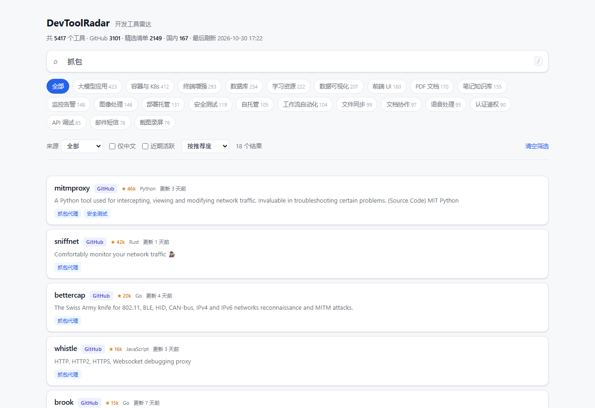

# DevToolRadar — 开发工具雷达

按「你想干什么」找开发工具，而不是按技术栈。覆盖 GitHub 高星项目、awesome 人工精选清单、国内 SaaS/AI 产品，每天自动刷新。

现在是 **5417 个工具**，68 个场景标签。**每一条都有自己的一句话说明**，没有一条是空的、也没有两条共用同一段说明。



**零第三方依赖**——只用 Python 标准库（`urllib`、`concurrent.futures`、手写的单文件网页和 stdio MCP 协议），
装个 Python 就能跑，不需要 `pip install`。需要 Python 3.9+，实测过 3.11 / 3.13 / 3.14。

## 快速开始

```bash
git clone https://github.com/<your-name>/DevToolRadar.git
cd DevToolRadar
```

**立刻能用，不用抓数据。** 仓库里带着索引和网页快照，直接打开 `site/index.html`
就有 5417 条可搜——离线、零外部请求、不需要服务器。

想要命令行：

```bash
python src/cli.py find "造测试数据"     # Windows 也可以直接双击 tool.cmd
./tool find "造测试数据"                # macOS / Linux
```

**想把数据刷新到当天**，跑一次完整抓取：

```bash
python src/refresh.py                   # 抓取 → 打标 → 建站 → 自检，约 15-20 分钟
```

第一次跑会重建全部三个源，速度卡在 GitHub 未认证限流（搜索 API 10 次/分钟）。
配个 token 能快 5 倍：

```bash
export GITHUB_TOKEN=ghp_xxxx            # Windows: setx GITHUB_TOKEN "ghp_xxxx"（重开终端生效）
```

**只重建网页（改完 config 之后）**：

```bash
python src/update.py --only-site        # 约 1 秒
python src/refresh.py --fast            # 不联网，用 data/raw_*.json 重建，约 7 秒
```

> `--fast` 需要 `data/raw_*.json`，那三个文件**不入库**（可重新抓取，且每天刷新会产生几 MB 的
> diff）。刚 clone 下来没有它们，直接跑 `--fast` 会中止并提示你先跑完整刷新——这是故意的，
> 没有缓存时重建会把 5417 条换成空索引。

抓取不发遥测、不写注册表、不装任何东西；除了 `data/`、`site/`、`logs/`，代码不往仓库外写文件。

## 怎么用

四种入口，共用同一份数据。同一个查询在哪儿搜都是同样的结果。

### 1. MCP —— 一次配置，所有 AI 客户端通用 ★

这是「换哪个大模型都能用」的正解。MCP（Model Context Protocol）是开放协议，
不绑任何厂商：Claude Desktop、Cursor、Cline、Windsurf、Continue、Codex CLI、
VSCode Copilot、Zed 都支持。

配置一次之后，你在任何客户端里问「有没有能 mock 接口的工具」，模型都会主动查这个索引，
而不是凭记忆编。

**配置方式**：把下面这段填进客户端的 MCP 配置，两处路径换成你自己的（绝对路径，用正斜杠）：

```json
{
  "mcpServers": {
    "devtoolradar": {
      "command": "python",
      "args": ["/absolute/path/to/DevToolRadar/src/mcp_server.py"]
    }
  }
}
```

`command` 写 `python` 也行——只要它在 PATH 上。路径不在 PATH 上就写完整路径，
Windows 上是 `C:/Users/<you>/AppData/Local/Programs/Python/Python311/python.exe` 这种形式。
**没有虚拟环境要激活，没有包要装**：`mcp_server.py` 只用标准库，手写了 stdio 上的 JSON-RPC 帧。

各客户端的配置文件位置：

- **Claude Desktop** — `%APPDATA%\Claude\claude_desktop_config.json`
- **Codex CLI** — `~/.codex/config.toml` 的 `[mcp_servers.devtoolradar]`
- **Cursor** — `~/.cursor/mcp.json`
- **Cline / Roo Code**（VSCode 扩展）— 扩展设置里的 MCP Servers，或 `cline_mcp_settings.json`
- **Windsurf** — `~/.codeium/windsurf/mcp_config.json`
- **Continue** — `~/.continue/config.json` 的 `mcpServers`
- **Zed** — `~/.config/zed/settings.json` 的 `context_servers`

> VSCode 的格式略有不同：用 `"servers"` 而不是 `"mcpServers"`，且每项要加 `"type": "stdio"`。

MCP server 提供四个工具：
- `find_tool` — 自然语言查工具（支持 query / tag / source / chinese_only / limit）
- `compare_tools` — 并排比两三个候选
- `list_scenarios` — 列出 68 个场景标签
- `get_stats` — 数据总量与新鲜度

**验证是否生效**：重启客户端后问一句「用什么工具能压缩图片」。
模型如果调了 `find_tool` 并给出带 star 数和链接的列表，就是通了。

配好之后跑一次 `python src/cli.py doctor`，第 4 项会去读这三个配置文件、检查里面写的
python 路径和 `mcp_server.py` 路径**是不是真的存在**——换解释器、挪目录这类会让客户端
静默失效的改动，当场就能露出来。没装的客户端会被记为「跳过」，不算问题。

### 2. 网页（最常用）

双击 `site/index.html`，或者：

```bash
python src/update.py --only-site   # 重新生成后打开
```

- 数据内联在 HTML 里，**不需要服务器，离线可用**
- 可拖到浏览器书签栏，或「安装为应用」放到桌面
- 快捷键：`/` 聚焦搜索、`j`/`k` 上下选择、`Enter` 打开、`Esc` 清空
- 查询可以写进链接直接打开：`index.html?q=抓包`、`index.html?q=部署&tag=自托管`。
  搜索结果能存书签、能发给人
- 同名工具（`bun`、`tabby`、`goose`）名字旁边有灰底的 `owner/repo`，不然两行长得一样分不清

### 3. 命令行

```bash
tool find "造测试数据"          # 自然语言提问即可
tool find -t "内网穿透"         # 按场景列全量
tool find "截图" -s cn -n 20    # 只看国内，返回 20 条
tool tags                       # 看有哪些场景
tool stats                      # 看数据总量和刷新状态
tool open                       # 打开网页
tool doctor                     # 自检：数据/MCP/客户端配置/网页 是否都还正常
```

`tool` 只是个转接脚本，等价于 `python src/cli.py <命令>`。两个平台各有一份：

| 平台 | 入口 | 用法 |
|---|---|---|
| Windows | `tool.cmd` | 双击，或把仓库目录加进 PATH 后用 `tool find ...` |
| macOS / Linux | `tool`（带执行位） | `./tool find ...`；想要全局就 `ln -s "$PWD/tool" /usr/local/bin/tool` |

**不想折腾 PATH**：`python src/cli.py find "造测试数据"` 一模一样的输出，任何平台都能跑。

想指定解释器（比如系统里有多个 Python）：设环境变量 `DEVTOOLRADAR_PYTHON` 指向它，
两个入口都会优先用它。

把仓库目录加进 PATH（Windows）：

```powershell
$p = [Environment]::GetEnvironmentVariable("Path","User")
[Environment]::SetEnvironmentVariable("Path", "$p;$PWD", "User")
```

### 4. 对话里直接问（仅 WorkBuddy）

已注册为 skill `dev-tool-radar`。作为 MCP 之外的兜底——万一某个客户端还没配 MCP，
在 WorkBuddy 里仍可直接问「找个能 mock 接口的工具」。

## 它凭什么准

难点不是「收集工具」，是「让『造数据』这种说法命中『接口 Mock』这个标签」。三层机制：

**第一层：场景标签，不按技术栈**
68 个标签全部是「你要干什么」——接口 Mock、内网穿透、性能压测、抠图、截图录屏。不是 React / Python / Go。

**第二层：口语 → 标签的别名表**
你问「造测试数据」「定时任务」「让外面访问我的本地服务」，配置里各标签的 `alias` 把这些说法翻译成场景。只取最长匹配，避免「本地大模型」同时命中「模型服务」和「大模型应用」。

**第三层：中英术语映射**
根本矛盾是**你用中文问，GitHub 工具描述是英文**，字面匹配永远是 0，排序就只剩看 star。`config/terms.json` 把「压缩」展开成 compress/compression/minify，让真正做压缩的工具盖过 star 更多的 OCR 工具。多词短语用词袋判断，所以「抠图」能命中 desc 里写 `remove images background` 的 rembg。

## 检索质量怎么保证

打分是个牵一发动全身的东西：改一处权重，全库排名都动。所以有 `tools/eval_search.py`：
32 条固定查询，每条写明「哪些工具该出现在前 3」，跑一次给出命中率。

```
python tools/eval_search.py        # 30/32 = 93%
python tools/eval_search.py -v     # 逐条看实际结果
```

**没有这个评测集，改打分就是碰运气。** 实测过一次：为了修「查我的 IP 搜出菜谱项目」，
第一版给所有英文词加了词边界，30 条查询里 16 条变差——`日志` 的第一名变成 `swift-log`，
`docker` 丢掉 lazydocker，`k8s` 丢掉 k8sgpt。

现在的规则是分开的：

- **名字用子串**：名字是标识符，复合词很正常（`ImgCompress`、`jsonhero`、`spdlog`）
- **描述用词边界**：描述是自然语言，词是分好的。`diff` 不该命中 `different`，
  否则整库一半条目都沾分，按 star 一排，第一名就是体量最大的不相干项目
- **只对 2 字符的缩写强制边界**：`ip` 命中 `VoIP`、`os` 命中 `postgres` 是纯误伤，
  但 `log` 命中 `logging` 是正常的词根匹配

另外两条规则是配套的：

- **中文查询的「整串命中」降权**：中文描述里出现「对比」「限流」这两个字太容易
  （画图工具写「左右对比」、小红书运营工具写「限流自查」），而英文正牌工具只能靠
  术语翻译拿六成分，不平权就是中文小工具站稳定压过正牌。所以中文整串命中名字只给
  180（英文 260），命中描述不给整串分（仍算分词分）。
- **术语展开取最长匹配**：查「数据库客户端」时，如果同时展开「数据库」→ database/sql，
  sqlmap（SQL 注入工具）会靠名字里的 sql 挤进前三。
- **名字命中和标签命中不叠加（仅中文）**：两者说的是同一件事——「这条属于这个品类」。
  叠加的后果是 ★3 的「草灰笔记」靠名字拿 180、靠标签再拿 305，搜「笔记」排第一。
  英文查询不适用这条：用户打英文多半就是在点名，名字命中是独立证据。
- **同义词表里不放品牌名**：「笔记」原来展开成 note / notes / notebook / **obsidian** /
  **logseq** / second brain。后果是任何提到 Obsidian 的插件、技能包、发版页都拿到
  「笔记」相关分，搜「笔记」第一名成了 `claude-obsidian`（一个 Obsidian 插件，★16k）。
  品牌名不是同义词，已剔除。

**两端同源是要验的，不是要说的。** 网页是另一份 JS 实现，改完在 node 里把网页脚本
抽出来跑，逐条对比同一个查询下每条的分数：10 个查询 × 2784 个（查询，条目）组合，
**不一致 0 处**。此前网页端少了「中文名字整串降权」「中文描述整串不给分」「星数加成」
三条规则——缺的后果是网页上 ★3 的工具能排第一，而命令行不是。

还剩 2 条没过：

- **`k8s 管理`**：前六名全是「容器与 K8s」里的工具，按星数排，k9s 排第 7。品类对、顺序不理想。
- **`笔记`**：前三名（vnote / note-gen / fsnotes）都是真笔记工具，但它们的名字里带 note，
  因此拿到英文名命中分；joplin（★57k）排第 7。这条是「相关度优先于星数」这条设计原则的
  直接后果，不是数据错误——想改就得重新定义这条原则，代价见下面「已知限制」。

## 数据完整性怎么保证

排序再好，条目不齐也没用。所以有两条独立的线：**有没有**、**齐不齐**。

一条命令看现状：

```bash
python tools/audit_data.py          # 说明、字段、场景各缺多少
python tools/audit_data.py -d desc  # 细看说明缺口
python tools/find.py -e bun         # 看单条的全部字段
```

### 说明：5417 条全都有，没有一条是空的

这件事不是自然发生的。有三类条目天生没有说明：

**1. 作者就没写。** GitHub 仓库的 description 字段是 null，抓一万次也还是 null。
`Unity-Technologies/EntityComponentSystemSamples`（8212 星）就是这种。这类只能人读 README 再写一句，
落在 `config/manual_desc.json`，按 URL 索引，无条件覆盖抓来的任何说明——这张表是人写的，
可信度天然高于自动摘要。目前 105 条。

**2. 名字本身就是说明。** `sdras/awesome-actions` 整个列表都是这个形态，条目叫
「Deploy to Netlify」，说明就到此为止。66 条全是这样，只能逐条翻译成中文动作描述。

**3. 中文说明比英文短，被长度比较判成「更短」。** 这个坑真踩过：
「自托管的碎片笔记应用…」35 个字，被原版英文 43 个字符判成「不如原文长」而不覆盖。
中英文按字符数比长度本来就没可比性，所以改成无条件覆盖。

另外，**同一段说明挂在两条上**也算不合格。`lxd` 和 `incus` 共用一句「Powerful system
container and virtual machine manager」——因为 incus 是 lxd 的分叉，README 直接沿用了。
这类必须写清区别，否则用户看不出该选哪个。doctor 里有一条专门查这个。

### 下架：确认不是工具的直接剔掉

awesome 列表是按「文章/资源」组织的，解析器只认 markdown 列表项，于是教程、面试题、
产品需求投票板全被抓了进来。查「React」冒出一篇官方教程，点进去发现不是工具——这比缺一条更伤。

`config/drop.json` 是下架表，判定标准很严，不确定的一律不删：

- 内容是讲解/教程/面试题/速查表，不是可运行的东西
- 页面是需求投票板、反馈看板这类根本不是产品的东西
- 页面是某个工具的官方文档片段，不是工具本身

已剔除 8 条。**`awesome-xxx` 这类清单仓库不在下架范围内**——它们虽然也是资源索引，
但确实指向一批工具，留着比删掉有用。

### 同名：95 组重名，197 条带上了 slug

`bun` 既是 JS 运行时（oven-sh）又是 Go ORM（uptrace），`tabby` 既是终端又是 AI 编码助手，
`goose` 有三条完全不同的东西（AI agent / 数据库迁移 / 压测）。列表里两行长得一模一样，
用户没法判断点哪个。

修法是在数据里算一次 slug（GitHub 用 `owner/repo`，其他站用域名），网页、CLI、MCP 三端
直接读同一个字段，不各自去猜。只在「slug 真的不同」时才标——同域名下的不同路径区分不了，
那类交给官网合并逻辑处理。

**顺便说一个没做的事**：`joplin` 的官网是 `joplinapp.org`、`micro` 是 `micro-editor.github.io`、
`jenkins` 是 `jenkins-ci.org`，域名主体和工具名对不齐，所以官网条目和仓库条目没合并，两组都在。
试过放开成「域名主体以名字开头」，多合并 13 条，其中 4 条是错的：`sentinelguard.io`（阿里限流组件）
并进了 `cartalyst/sentinel`（PHP 权限库），`coralproject.net`（Vox Media 评论系统）并进了另一个 CORAL。
又试过加一道「两条说明得有共同词」的门槛，还是失败——两个无关项目都写 code / source，套话让判据失效。
结论是这件事规则做不了。宁可留两条重复（现在有 slug 能分清），也不能把两个真产品并成一个。

### 搬家：9 个换了组织/改了名的仓库，旧地址已并进新地址

这件事是被补星数引出来的。旧组织那半边原来 star=0，被质量分压在几千名下面，看不见；
星数补齐后两边同时浮上来——搜「终端」，`jwilm/alacritty` 和 `alacritty/alacritty`
并排第 2、3 名，说明还是两种措辞（「Cross-platform, GPU-accelerated…」/「A cross-platform,
OpenGL…」），用户会当成两个工具。

判据只有一条是硬的：**GitHub 自己的 301**。仓库换组织或改名之后，旧地址会跳到新地址；
`fetch_gh_meta.py --moved` 只探「名字看起来是同一个仓库」的组——包括去掉连字符后同名的
（`oh-my-zsh` vs `ohmyzsh`，换组织的同时还改了名，第一批只按名字全等分组时漏掉了，两条并排
在搜「终端」的第三、四名）。58 组 128 个地址，一次 36 秒，把跳转记进 `data/gh_moved.json`，
归一化时按记录合并，留新地址那条。

星数接近、名字相同都不能当判据，试过就知道：`express-typescript` 有两条，星数 ★1247 和
★1259，仓库名一字不差，但它们确实是两个不同项目（edwinhern 和 GeekyAnts 各写了一个）。
只靠「像不像」去合，迟早把两个真产品并成一个。

合并时精选身份要保住：旧地址那条如果来自精选清单，`origin` 提上来（`[精选]` 标记和
5 分质量分都在它身上），名字、分类、人工说明也优先留人工写的那份——`Alacritty` 比
`alacritty` 更像人写的。旧地址记进索引的 `moved_from` 字段，doctor 每次自检都反过来核对
「记录里的旧地址有没有真的并走」，记了 9 条就查 9 条。

## 打标签的那些坑（已处理）

- **topic 滥用**：项目会为了被搜到而滥打热门 topic，一个仪表盘也标 docker/kubernetes。所以字段权重是 `名字 3.0 > 分类 1.5 > topics 1.35 > 描述 1.0`。
- **"支持 docker 部署" ≠ "是容器工具"**：`容器与 K8s`、`部署托管`、`自托管`、`CI/CD`、`学习资源`、`工作流自动化` 六个标签标了 `weak`，判定阈值更严，且**已有业务归属的工具不再加这些标签**。这一条把容器类从 484 条收敛到 263 条。
- **描述顺带一提不足以归类**：次要标签必须有名字/分类/topics 支撑。

## 目录

```
DevToolRadar/
├── config/                    ← 只改这里，不用碰代码
│   ├── sources.json           抓哪些 GitHub topic、解析哪些 awesome 仓库、必收录白名单
│   ├── scenarios.json         场景标签：kw 打标用、alias 翻译口语、weak 严判
│   ├── terms.json             中英术语映射
│   ├── eval_queries.json      检索评测集：查询 → 该出现的工具
│   ├── manual_tags.json       人工判读表：每条 URL 该归哪个场景（写 null = 确认无场景）
│   ├── manual_desc.json       人工说明表：作者没写简介的条目，人补一句话
│   ├── drop.json              下架表：确认不是工具的（教程、面试题、需求投票板）
│   ├── topic_map.json         任务型 topic → 场景的显式映射
│   └── cn_tools.json          国内工具种子清单（167 条，人工维护）
├── src/
│   ├── refresh.py             刷新入口（抓取 → 打标 → 建站 → 自检，全程写日志）
│   ├── update.py              刷新主体：抓源 + 归一化 + 建站
│   ├── mcp_server.py          MCP server（零依赖，stdio）← 跨客户端通用
│   ├── fetch_github.py        GitHub Search API + 必收录白名单
│   ├── fetch_awesome.py       awesome README 解析（含阮一峰周刊）
│   ├── fetch_cn.py            国内清单 + 官网存活校验
│   ├── normalize.py           去重、打标、质量分 —— 系统的心脏
│   ├── build_site.py          生成单文件检索页
│   ├── search.py              检索核心（CLI/MCP/skill 共用）
│   └── cli.py                 命令行入口
├── data/
│   ├── tools.json             归一化后的索引（5417 条）
│   ├── stats.json             刷新时间、各源状态、分布统计
│   └── raw_*.json             各源原始落盘（单源故障时的回退）
├── tools/
│   ├── eval_search.py         检索评测：跑固定查询集，看期望工具在不在前 3
│   ├── audit_data.py          数据体检：说明、字段、场景各缺多少，一条命令看清
│   └── find.py                按名字精确找一条，看它的全部字段
├── site/index.html            检索网页（单文件，约 1.3 MB）
├── docs/screenshot.png        README 用的截图
├── logs/                      刷新日志（refresh.log 追加式，update-YYYY-MM.log 按月，不入库）
├── tool / tool.cmd            命令行入口（POSIX / Windows）
├── refresh / refresh.cmd      手动刷新（内部调 src/refresh.py）
├── LICENSE                    MIT
└── .gitignore
```

**哪些东西入库**：代码、`config/`、`data/tools.json` + 少量元数据缓存、`site/index.html`。
**哪些不入库**：`data/raw_*.json`（抓取中间产物，3.7 MB，可重新抓）、`logs/`、`data/health.json`。

所以 clone 下来就有索引、能立刻搜；但 `--fast` 那种「不联网重建」要等你跑过一次完整刷新。

## 更新机制

三个触发点，最后都汇到同一个脚本 `src/refresh.py`：抓取 → 补 GitHub 元数据 / 查仓库搬家 → 打标 → 建站 → 自检。

**自动：** 不需要什么框架，任何能定时跑命令的东西指向 `python src/refresh.py` 就行：

```bash
# Linux / macOS：crontab -e
0 3 * * * cd /path/to/DevToolRadar && ./refresh >> logs/cron.log 2>&1
```

- **Windows** — 任务计划程序，操作填 `python`，参数 `src\refresh.py`，起始于仓库目录。
  如果 `schtasks` 被安全软件拦住了，用图形界面建同样的任务即可。
- **GitHub Actions** — 可行，但要把 `data/` 提交回仓库，得给 workflow 写权限；
  每天的自动提交会让提交历史变得很吵，是否值得自己权衡。

**自愈：** 每次用 `tool` 查东西时会检查数据新鲜度，超过 3 天自动在后台起一次 `refresh.py`，不阻塞你的查询。输出丢给 DEVNULL，但过程照样写进 `logs/refresh.log`。

**自检：** 抓完自动跑一次 `tool doctor`，结论写进 `data/health.json`。没过的话，`tool find` 开头会直接提示，MCP 的 `get_stats` 也会带一句——不需要你记得去翻日志。

```bash
tool doctor        # 22 项：数据新鲜度 / 索引完整性 / 说明覆盖率 / MCP 握手 / 三个客户端配置 / 网页同步 / 检索冒烟
```

检查的是「配置指向的文件真的存在」而不是「字符串跟这边一样」，所以换解释器、挪目录这类会让客户端静默失效的改动会当场露出来。

**手动：**

```bash
python src/refresh.py            # 完整刷新 + 自检，约 15-20 分钟
python src/refresh.py --fast     # 不联网，用缓存重建，约 7 秒（改完 config 用这个）
```

双击 `refresh.cmd` 等价于第一条。每次运行都往 `logs/refresh.log` 追加一段，含 python 路径、工作目录、每一步的退出码和耗时，输出是流式的——跑一半卡住也能看出卡在哪。

**为什么不用 `update.py` 直接跑**：它只负责抓数据和建站，不跑自检。以前三个触发点都只调它，于是 `health.json` 永远是旧的，坏了也没人知道。`refresh.py` 是唯一入口，这条缝已经堵上。

**部分更新：**

```bash
python src/update.py --no-github        # 只更 awesome + 国内（约 40 秒）
python src/update.py --only-site        # 只重新生成网页（1 秒）
python src/update.py --no-cn            # 不动国内清单
```

任一源抓取失败会自动沿用上次缓存，并在 `stats.json` 里标 `cached`，不会摧毁整个索引。

## 想加工具 / 加场景

**加一个国内产品**：往 `config/cn_tools.json` 的 `tools` 里加一条，`tags` 用 `scenarios.json` 里的标签名。

**加一个新的"你想干什么"**：往 `config/scenarios.json` 加：

```json
{
  "label": "视频转码",
  "desc": "格式转换、压缩、加水印",
  "kw": ["transcode", "video conversion", "转码"],
  "alias": ["视频转码", "转格式", "压缩视频"]
}
```

`kw` 用于给工具打标签，`alias` 用于理解你的问法。改完跑一次 `python src/update.py`。

**加一批 GitHub 仓库**：`config/sources.json` 的 `github.queries` 加 topic；如果某个核心工具怎么都搜不到，加到 `pinned.repos` 白名单（实测纯 topic 搜索会漏掉约 13/29 的核心工具）。

**补「工具自己标了功能、但没被收进来」的场景**：`config/topic_map.json`。GitHub 的 topics 多数是技术栈（python/docker/cli），但有一批词说的就是功能本身（`image-processing`、`text-to-speech`、`note-taking`），这张表把这类 topic 映射到场景。约束是只补空——已有标签的条目一律不碰，所以是纯增量。加新键前先按注释里的验收方法抽查，`tunnel`、`mock`、`web-scraping` 三个键就是抽查后删掉的。

**人工判定某个工具的归属**：`config/manual_tags.json`。按 URL 索引，值写场景名；写 `null` 表示「确认它不属于任何场景」。**这张表的优先级高于任何规则**——有值时用人工结论，`null` 时清空规则结果，没记录才走规则。什么时候用它：作者的自述用的是词表里没有的说法（jq 说自己是「JSON processor」、pandoc 说自己是「markup converter」），规则匹配不到，人读一眼就知道；反过来，规则把「名字带 log 但不是日志系统」的东西捞错了（TeslaMate、Wavelog），也靠它否决。这个文件不参与自动更新，新的高星无标签项目需要人工追加——跑 `python src/refresh.py --fast` 会打印「人工判读表：补标签 N 条，确认无场景 M 条」。

**人工补一条说明**：`config/manual_desc.json`。按 URL 索引，值是中文说明，**无条件覆盖**抓来的任何描述。什么时候用它：作者压根没写 description（GitHub 上是 null，抓不到）、或者说明是营销口号（`vercel` 写「Develop. Preview. Ship.」）、或者干脆是公告（`BookStack` 写「NOW MANAGED ON CODEBERG」）、或者只是把名字换个写法又说了一遍（`mongo` 写「The MongoDB Database」）。写的时候说清「它是什么 + 用来干什么」，别复述名字。改完跑 `python src/update.py --no-github --no-awesome --no-cn`，日志会打印「人工说明表：补写 N 条」。

**下架一个不是工具的条目**：`config/drop.json`。教程、面试题、需求投票板、某个工具的文档片段——这些被抓进来只会污染检索。判定标准见文件头的注释，很严，不确定就别加。

**检查补得对不对**：`python tools/audit_data.py` 看缺多少，`python tools/find.py -e 名字` 看单条。`tool doctor` 里也有三项守着：说明覆盖率、说明重复、人工表是否对得上索引。

## 已知限制

- **GitHub 未认证限流**：全量刷新约 10 分钟（搜索 API 10 请求/分钟）。配一个 token 能提速 5 倍并把覆盖抓得更深：

  ```powershell
  setx GITHUB_TOKEN "ghp_xxxx"     # 新开终端生效
  ```

- **awesome 条目丢弃率约 52%**：无法归入任何场景的条目会被丢掉（2600 条左右）。这是刻意的——没有 star 背书又没有场景归属的条目，对"找工具"没价值。
- **还有 1.7%（90 条）缺场景归属，全部是人工读过、确认不归任何场景的**：这类条目描述里没有出现任何场景词汇，或者只出现在长描述末尾的「我还支持 X」清单里。后者用「命中词在描述前 90 字内」区分定位句和支持清单，能救回 fzf、plane、AFFiNE、crewAI 这类把定位句写在开头、后面拖一串用途的项目；但代价是个别误判会浮上来（问「漏洞扫描」时 ECC 排第一，它其实是 agent 工具）。
  剩下这批里，多数条目的 topics 其实指向正确场景，只是描述里没出现关键词而被整条弃用（body 过滤器）。这类证据不参与主判定（一放行就重演连锁改判），只在「完全无标签」时兜底补一个：要求同一场景至少命中 2 个 topic；数据库/认证鉴权/监控告警/部署托管/自托管/性能压测这 6 个「人人能沾」的场景提高到 3 个。
  最后一档是 `config/manual_tags.json`，五批读完 868 条，表里最终留 614 条结论：518 条补上场景，96 条写 `null` 确认「本来就没有场景」（这 96 条里有 6 条在合并同产品重复入口时被吞掉，所以数据里实际剩 90 条无场景，第六批又从中收走 it-tools，现在 89 条）。第一批 52 条是 3 万星以上仍无归属的；第二批 52 条是「规则差一点」的（命中了但只有一个词沾边、分数 1.0，被单次命中过滤挡在门外）；第三批 559 条是规则完全够不到的——一个关键词都匹配不到，因为类目不在当时的 52 个场景里。
  能补上的是因为作者自述用的是词表外的说法：jq 写「Command-line JSON processor」、pandoc 写「Universal markup converter」、bubbletea 写「TUI framework」；mikro-orm 的「数据库」其实拿了 5.0 分、命中 5 个词，但全在 topics 里，正文一个都没出现，于是被「只靠 topics 不算数」的规则整条弃用——人读一眼就知道它是 ORM。第三批里同类情况很多：ORM（ent / efcore / Exposed / PetaPoco / nhibernate）、接口 Mock（nock / mockk / miragejs / ng-mocks / Cuckoo / mockolo）、消息队列（bull / liftbridge / Rebus / blazingmq / sqs-consumer）、代理客户端（ClashMac / mieru / GreenTunnel / glider）、测试框架（jasmine / Quick / doctest / spock / TUnit / tox）。
  确认为空的包括 vscode / lapce（编辑器本体，场景里的「编辑器插件」指插件）、node / deno（语言运行时）、django（Web 框架）、nhost / trailbase（Firebase 替代，没有「后端服务」这一类）、以及 CMS、加密货币、生物信息、DNS 服务器、静态站点生成器、各类语言/框架运行时这些没有对应类目的项目。表里记为 `null` 的表示「读过了、确认不归任何场景」。
  第四批 80 条是「开了新类目才有地方去」的：补了 14 个场景（Web 框架、CMS 与建站、代码生成、包管理与仓库、
调试与剖析、对象存储、数据分析与实验、编译器与虚拟机、代码编辑器、语言运行时、区块链、CRM 与 ERP、
Markdown 处理、桌面与系统工具），一次性收进 300 多条，无标签从 267 降到 207，剩下 80 条逐条读完。
  第五批 125 条是收尾：38 条归进现有场景（服务发现 Consul、防火墙 OPNsense、Windows 兼容层 winapps / winboat、
BaaS nhost / trailbase / floci、容器底层 CRIU / toolbox / dragonfly、多平台发布 Wechatsync 这类之前散在外面的），
88 条判 `null`。判空的几乎全是「库 / 零件 / SDK」——HTTP 客户端（got、wretch、mande、pycurl、dart-lang/http、
node-fetch、async-http-client、fuel、beast、gun）、各家 API 的官方封装（notion-sdk-js、ruby-openai、binance、
Mastodon.py、pyowm、wechatpay-go、huggingface.js、两个 Firebase SDK）、单点小库（DOMPurify、valtio、click、
go-cmp、easyjson、tsdoc）。这些是「装进项目里的零件」，不是「拿来就用的工具」——按场景浏览时出现只会稀释列表，
所以不建类目、也不硬塞。
  第六批 10 条是那次「能不能生成 uuid」的问诊引出的：这类工具是「一堆小工具的合集」，
天生没有场景可归，于是中文查询永远落不到它身上（中文问法要先翻成场景标签）。为此补了第 68 个场景
`开发者工具箱`，收 it-tools(41k)、DevToys(32k)、omni-tools(11k) 等 10 条，
并在 alias 里挂了 uuid / 正则 / base64 / 哈希 / 时间戳 / json 格式化 这些具体功能词。
现在问「uuid」直接出 it-tools，问「正则」出的是在线工具箱而不是空白。
- **第 53 个场景「日志与追踪」是后补的**：前三轮读下来发现日志类无处可去，spdlog(29.7k)、logrus(25.7k)、zap(24.6k)、loguru(24.1k) 四个 2-3 万星的项目全悬空，因为 52 个场景里没有「日志」。补上之后一次收进 42 条（全是日志库/日志平台），另改判 14 条（kail、kubetail、khi、logging-operator 这类 K8s 日志工具从「容器与 K8s」移到日志场景更准）。
  开新场景的代价要正视：`logging`、`logger` 这类词的语义太宽——**「记录数据的软件」全都符合**。实测捞进过 TeslaMate（特斯拉车辆数据记录）、Wavelog（业余无线电通联日志）、wger（健身记录）、gpslogger（GPS 轨迹）、SignalTo（交易信号转发）。这批已在人工表里逐个否决，并因此改了代码：人工表的否决权现在**压过规则**，不再只在规则沉默时才有话语权。否则新场景每加一个词，都会带进来一批「名字带 log、但不是日志系统」的东西。
- **后补的 14 个场景，有三个是在「词太泛」上翻过车的**：第一版叫「运行时与编译器」，`runtime` 把 bun（运行时）、herdr（agent runtime）、ray（AI 计算引擎）、tamagui（UI 库）、falco（运行时安全）全捞进来，改成「编译器与虚拟机」并删掉 `runtime` 才干净；「数据分析与 Notebook」的 `notebook` 把纸质笔记本 PDF 生成器、dnote（笔记应用）也收进来了，改叫「数据分析与实验」，只留 `jupyter` / `experiment tracking` / `feature store`；「代码生成」的 `boilerplate` 把 SaaS-Boilerplate、vuesion 这类启动模板源码当成了代码生成器。教训是**别用能描述「一类东西的形态」的词做关键词**，只用描述「功能」的词。
- **2 字符缩写会命中别的单词内部**：查「查我的 IP」时 `ip` 会命中 `VoIP`（Vo-IP）和 `Recipes`（rec-ip-es），
结果第一名是一个 SIP 监控工具和一个菜谱项目；`os` 会命中 `postgres`。修法是**只对 2 字符的英文词要求词边界**，
3 字符以上仍按子串——因为 `log` 必须能命中 `spdlog`/`logrus`，`k8s` 要命中 `k8sgpt`，`json` 要命中 `jsonhero`，
`docker` 要命中 `lazydocker`。全上词边界会让「日志」的第一名变成 `swift-log`（实测）。
改完 30 条查询里只有「查我的 IP」变了，其余 29 条逐条一致，没有副作用。
网页端是另一份 JS 实现（`build_site.py` 里的 `score()`），这条规则两边都改了。
**注意：当时两边并不真的完全一致**——JS 少了三条中文规则和星数加成，这个洞直到 2026-10-30
 才补上并逐条核对（见「检索质量怎么保证」里 2784 个组合 0 差异那段）。凡是改打分，两端都要验。
- **「工具箱」这类目，kw 一个都不能信**：实测 `toolbox` 会吸进 mcp-toolbox（数据库 MCP）、ImageToolbox（图片编辑）、
lemo-opuscar（大模型素材）；`utilities` 吸进 enzyme、react-testing-library（都是测试工具）；中文 `工具箱` 吸进
PDF补丁丁、这图能改、匠工具箱——全是「专用工具箱」，不是「开发者日常小工具合集」。所以这个场景只在 kw 里留了
`online tools`（全库只命中 it-tools 和它的 fork，干净），成员**全部由人工表列**，没让规则猜。
顺带发现库里缺了 CyberChef（编码解码事实标准），已加进 `sources.json` 的 `pinned.repos`，下次抓取进来。
- **`语言运行时` 只有 3 条（node / deno / bun），是全库最窄的场景**：留着是因为它答的问题是「我想跑 JS，用哪个」，这三条就是全部答案，硬塞别的反而错。`bun` 同时是打包器、测试器和包管理器，这里按它的头号身份归到运行时。
- **国内清单靠人工**：167 条是国内 SaaS/AI，没有可枚举的公开 API，只能人工维护 + 每次探活。探活失败的会标「站点不可达」但仍保留（可能是临时故障）。
- **同名不同物不会被合并，但会带上标识**：`tabby` 既是终端也是 AI 编码器，`bun` 既是运行时也是 ORM，`ollama` 官方仓库和 Python 客户端也是两回事。只有真能证明是同一个东西的才合并成一条：name 和 desc 完全相同（项目换组织留下的双份，v2ray→v2fly、ginuerzh/gost→go-gost，2 组），或者 GitHub 把旧地址 301 到新地址（9 组，见上一节）。全库共 11 组。
  剩下 95 组重名不合并（合并会把两个真产品并成一个），改在名字旁边显示 `owner/repo`，让人能分清。只在 slug 真的不同时才标，同域名下不同路径区分不了。
- **`lang` 缺 44.5%、`pushed_at` 缺 24.3%，两个字段的处境完全不同**：

  | 字段 | GitHub 源（3101 条） | 精选清单源（2149 条） | 国内源（167 条） |
  |---|---|---|---|
  | `lang` | 缺 4.1% | 缺 99.5% | 缺 85.6% |
  | `pushed_at` | 缺 0% | 缺 55.5% | 缺 75.4% |

  `pushed_at` 原来是缺 42%，这一轮补到 24.3%：`fetch_gh_meta.py` 用 ungh 代理把精选清单里
  1001 个 GitHub 仓库的星数、更新时间补了一遍（一次跑完 943 条，失败 0）。剩下 1192 条是
  官网 / App Store / Chrome 商店，这些页面没有「最后一次提交」这个概念。

  `lang` 补不动：ungh 代理的返回里根本没有 `language` 字段；GitHub 仓库页面的语言区块是
  React 骨架屏，HTML 里拿不到实际值；只剩 GitHub API 一条路，而无 token 只有 60 次/小时。
  剩下 1129 条按星数降序排进每日刷新，一天 60 条，约 18 天补完 —— 先补用户最可能遇到的。

  补元数据的直接后果是**排序整体变了**，不是补信息：当时 5426 条里 5405 条发生位移，718 条位移
  超过 1000 名。上升最猛的是原本被当成 0 星的：`oh-my-zsh`（19 万星）从 5331 名到 23 名，
  `Terminus`（7.5 万星）从 5377 到 32 —— 19 万星排 5331 名本身就是荒谬的。
  检索评测从 87% 升到 93%，「文件同步」「shell 美化」两条自己就好了。

- **泛类词仍按「名字贴合度」优先于星数**：搜「笔记」，前三名是 vnote / note-gen / fsnotes
  （★7.5k–13k），joplin（★57k）第 7。这不是数据错误，是设计取向的直接后果：`score()` 里
  星数只是最多 120 分的微调，而「名字里含这个词」值 62 分，刚好能跨一个 100 分的档。
  想把星数抬上去只有两个旋钮，两个都试过、都赔：
  - 放宽档位到 150/180：评测从 30 掉到 25/24（终端、容器、去广告、压缩图片一起坏）
  - 去掉名字命中的分（或降到 30）：掉到 22–25，`压缩图片`、`向量检索`、`代码格式化` 全塌

  根子在于这两条路都是在改「相关度优先于影响力」这个全局原则，不是修某个局部错误。
  要动它得先决定产品取向：泛类词到底是「按品类热度排」还是「按命名贴合度排」，两者不能兼得。
- **评测集自己也不自洽，只能看趋势，不能当唯一裁判**：`终端` 期望 alacritty / kitty 进前三，
  而它们能进前三靠的恰恰是名字里含 `tty`——和 `vnote` 里含 `note` 是同一种字母巧合。
  同一类证据，在一个查询里是期望答案，在另一个查询里是噪声。所以别拿 32 条去换一个
  「调参调绿」，那只会把错误挪个位置。

- **`category` 缺失 53.5%，但它不是问题**：这个字段在网页里只参与算分、**从不展示**，CLI 和 MCP
  完全不读它。它只是打标的第二高权重证据（1.5，仅次于名字的 3.0）。GitHub 源没有它，靠 name、
  topics、desc 三个证据照样能打准。把它当「缺字段」是错的口径。

- **90 条无场景不是缺失，是结论**：其中 89 条是人工逐条读过后明确写 `null` 的（「读过了，
  确认不属于任何场景」），1 条是补说明后标签归空、已补记。这批里多数是「库」而不是「工具」——
  xstate（状态机）、click（CLI 库）、got（HTTP 客户端）、DOMPurify（XSS 过滤）是装进项目里的零件。
  场景表按「你想干什么」设计，没有「基础库」这个类目，硬建一个只会把列表稀释掉。
  它们照样能被搜到，只是不出现在场景导航里。

- **网页已经过截图验证**：无头 Chrome `--headless=new --screenshot` 可用，注意 `--screenshot=` 必须给
  Windows 绝对路径，相对路径会报「拒绝访问 0x5」。

## 想贡献

这个仓库的价值一半在代码，一半在 `config/` 里那几张人工表——它们不需要写代码就能改，
而且比改算法安全（规则动一处，全库排名都动；表加一行，只影响那一行）。

- **补一个工具的场景归属** → `config/manual_tags.json`，按 URL 索引，写 `null` 表示「读过了，确认不属于任何场景」
- **补一条说明** → `config/manual_desc.json`，无条件覆盖抓来的描述
- **加一个国内产品** → `config/cn_tools.json`
- **加一个「你想干什么」** → `config/scenarios.json`，`kw` 用于打标、`alias` 用于理解问法
- **下架一个不是工具的东西** → `config/drop.json`

改完跑 `python tools/audit_data.py` 看缺多少，`python src/cli.py doctor` 看有没有破规则。

**动打分之前先跑评测**：`python tools/eval_search.py`（当前 30/32 = 93%）。
改一处权重，全库排名都动——没有评测集，改打分就是碰运气。而且**两端都要验**：
网页里是另一份 JS 实现（`build_site.py` 的 `score()`），改完得逐条对比。

## 许可

MIT，见 `LICENSE`。工具元数据来自各项目的公开信息（GitHub API、awesome 清单、
各产品官网），版权归各自所有者。
